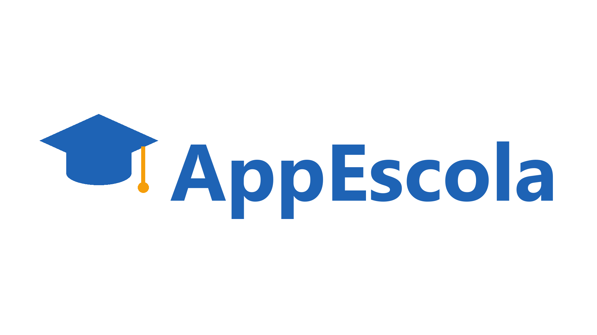

<p align="center">
  
</p>

<p align="center">
  Dois aplicativos móveis que ligam a escola a professores e famílias.<br>
  Feitos em <b>Flutter</b> com <b>FlutterFlow</b>, integrados a uma API REST.
</p>

<p align="center">
  
  
  
  
</p>

---

## Sobre o projeto

O **AppEscola** digitaliza a rotina de uma escola de ensino básico. São dois apps, um para cada lado da relação escola–família:

| App | Para quem | Pasta |
|---|---|---|
| **AppEscola Professores** | Professores registram aulas, chamada e o acompanhamento de cada aluno | [`apps/professores`](apps/professores) |
| **AppEscola Responsáveis** | Pais e responsáveis acompanham a vida escolar dos filhos | [`apps/responsaveis`](apps/responsaveis) |

Os dois usam o mesmo backend, a mesma autenticação e a mesma base visual. Assim, o que o professor lança aparece para o responsável.

## Funcionalidades

### App dos professores
- **Minhas turmas:** lista as turmas e os alunos de cada uma.
- **Chamada:** lança e atualiza a presença da aula.
- **Diário de classe:** cria e edita aulas com o conteúdo dado.
- **Ocorrências e anotações:** registra ocorrências por aluno, a partir de modelos (templates).
- **Questionários:** responde e edita listas de perguntas sobre o desenvolvimento do aluno.
- **Agenda e horários:** mostra a grade de aulas do professor.
- **Comunicação:** mural, comunicados e cardápio da escola.

### App dos responsáveis
- **Minhas crianças:** um painel por aluno quando há mais de um filho matriculado.
- **Diário e conteúdos de aula:** mostra o que foi trabalhado em sala.
- **Ocorrências:** acompanha as anotações feitas pelos professores.
- **Agenda e horários de aula.**
- **Cardápio, mural e comunicados da escola.**

## Arquitetura

```
appescola/
├── apps/
│   ├── professores/        # App Flutter dos professores
│   │   └── lib/
│   │       ├── auth/            # Autenticação própria por token
│   │       ├── backend/         # Chamadas à API REST (api_calls.dart) e schemas
│   │       ├── routes/          # Turmas, chamada, aulas, agenda
│   │       ├── info_aluno/      # Ocorrências, anotações, diário, questionários
│   │       ├── pages/           # Home, mural, comunicados, cardápio, horários
│   │       └── flutter_flow/    # Navegação (go_router), tema, utilitários
│   └── responsaveis/       # App Flutter dos responsáveis (mesma estrutura)
└── README.md
```

- **Navegação:** `go_router`, com rotas protegidas por login.
- **Estado:** `provider` e o `FFAppState` gerado pelo FlutterFlow.
- **Autenticação:** login por usuário e senha. O token vem da API e fica salvo localmente (`shared_preferences`).
- **Backend:** API REST consumida com `http`. São 18 endpoints no app dos professores e 12 no dos responsáveis, centralizados em `lib/backend/api_requests/api_calls.dart`.
- **UI:** tema próprio, `google_fonts`, animações com `flutter_animate` e `lottie`, e imagens em cache com `cached_network_image`.

## Como rodar

Pré-requisitos: [Flutter SDK](https://docs.flutter.dev/get-started/install) 3.x.

O endereço da API e a chave de acesso **não ficam no código**. Eles entram na hora do build:

```bash
cd apps/professores        # ou apps/responsaveis
flutter pub get
flutter run \
  --dart-define=API_BASE_URL=https://sua-api.exemplo.com/admin \
  --dart-define=API_KEY=sua-chave
```

> A API original é privada. Sem um backend compatível, o app abre na tela de login, mas não autentica.

## Imagens

<!-- Adicione aqui capturas de tela dos dois apps, por exemplo:
<p align="center">
  
  
  
</p>
-->

_Em breve._

## Meu papel

<!-- Descreva sua participação: o que você projetou, o que implementou, decisões técnicas, desafios. -->

Projetei e desenvolvi os dois aplicativos: telas, fluxos de navegação, integração com a API e autenticação.

## Observações

Este repositório é uma versão de portfólio. A marca da escola, os endereços de servidor e as credenciais foram removidos. As imagens institucionais foram trocadas por ilustrações genéricas.
