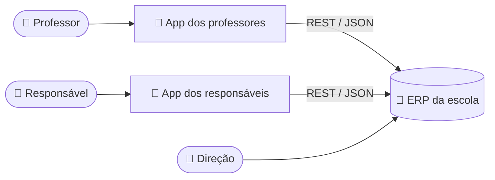

# AppEscola — Documentação

Documentação de engenharia de software do **[AppEscola](../README.md)**, dois apps móveis (professores e responsáveis) que ligam a escola às famílias.

Aqui estão os artefatos da análise e do projeto: requisitos, casos de uso, diagramas de sequência, arquitetura C4 e o contrato de API.

## Conteúdo

| Artefato | Descrição |
|---|---|
| 📄 [Documento de requisitos](requisitos/documento-de-requisitos.md) | Escopo, regras de negócio (RN), histórias de usuário (HU), requisitos não funcionais (RNF), modelo de classes e glossário |
| 🎭 [Casos de uso](casos-de-uso/) | Atores (professor, responsável, secretaria) e suas funções, com a rastreabilidade até as HUs |
| 🔁 [Diagramas de sequência](sequencia/) | Fazer chamada, responder lista de perguntas, lançar anotação e lançar ocorrência |
| 🏛️ [Arquitetura C4](arquitetura/c4.md) | Diagramas de contexto e de contêineres, com as decisões de arquitetura |
| 🔌 [Lista de APIs](api/lista-de-apis.md) | Contrato das chamadas entre os apps e o ERP da escola |

## Visão rápida

## Como ler

1. Comece pelo **[documento de requisitos](requisitos/documento-de-requisitos.md)**, que explica o problema e as regras.
2. Veja nos **[casos de uso](casos-de-uso/)** quem faz o quê.
3. Os **[diagramas de sequência](sequencia/)** mostram cada fluxo, passo a passo, até a API.
4. O **[C4](arquitetura/c4.md)** mostra como as partes se encaixam.

Os diagramas estão em [Mermaid](https://mermaid.js.org) e o GitHub desenha todos eles. As fontes originais (sequencediagram.org e draw.io) ficam ao lado de cada um.

## Observações

Esta é uma versão para portfólio. Nome da escola, endereços de servidor e dados reais foram removidos. Os exemplos usam dados fictícios.
