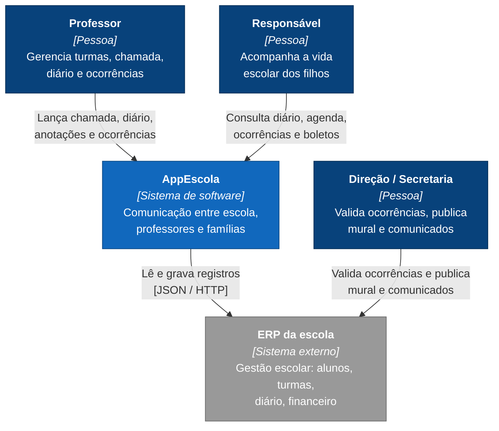
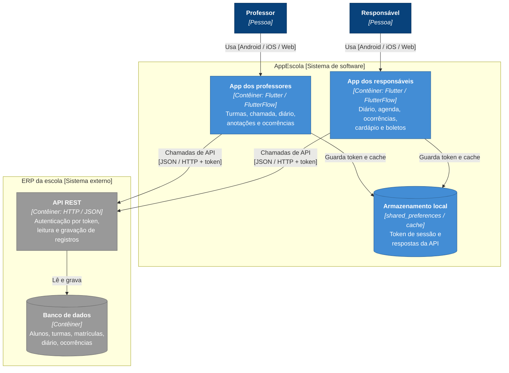

# Arquitetura — Modelo C4

Visão da arquitetura do AppEscola nos dois primeiros níveis do [modelo C4](https://c4model.com): **Contexto** e **Contêineres**.

## Nível 1 — Contexto do sistema

Quem usa o AppEscola e com quais sistemas ele conversa.

## Nível 2 — Contêineres

O AppEscola tem dois aplicativos móveis separados, um por perfil de usuário. Os dois consomem a API REST do ERP da escola.

## Decisões de arquitetura

| Decisão | Motivo |
|---|---|
| **Dois apps separados** em vez de um app com perfis | Mantém a complexidade sob controle e separa as responsabilidades de cada público (ver [requisitos, seção 2.1](../requisitos/documento-de-requisitos.md#21-descrição-do-sistema)). |
| **Integração com o ERP existente** em vez de um backend próprio | A escola já gerencia alunos, turmas e financeiro no ERP. O app só lê e grava registros por API, sem duplicar dados. |
| **Autenticação por token** com nova exigência de login quando a sessão expira | Atende ao RNF04 e protege os dados das crianças (LGPD, RNF02). |
| **Cache das respostas da API** | Reduz o tempo de resposta e melhora a experiência de uso (RNF03). |
| **Flutter com FlutterFlow** | Um só código para Android, iOS e Web (RNF05), com prototipação rápida das telas. |
