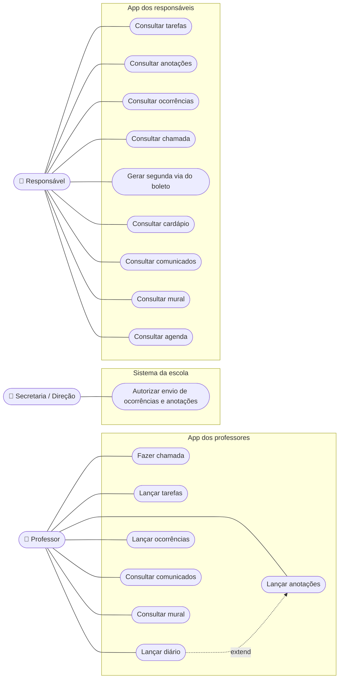

# Diagrama de casos de uso

Atores e casos de uso do AppEscola. Fonte original: [`casos-de-uso.drawio`](casos-de-uso.drawio). Abra no [diagrams.net](https://app.diagrams.net) para editar.

## Rastreabilidade

| Caso de uso | História de usuário | Diagrama de sequência |
|---|---|---|
| Fazer chamada | HU05 | [fazer-chamada](../sequencia/fazer-chamada.md) |
| Lançar diário | HU06 | [responder-lista-de-perguntas](../sequencia/responder-lista-de-perguntas.md) |
| Lançar anotações | HU03 | [lancar-anotacao](../sequencia/lancar-anotacao.md) |
| Lançar ocorrências | HU04 | [lancar-ocorrencia](../sequencia/lancar-ocorrencia.md) |
| Lançar tarefas | HU07 | — |
| Consultar chamada | HU10 | — |
| Gerar segunda via do boleto | HU11 | — |
| Consultar agenda | HU12 | — |
| Consultar cardápio, comunicados e mural | HU14–HU16 | — |
