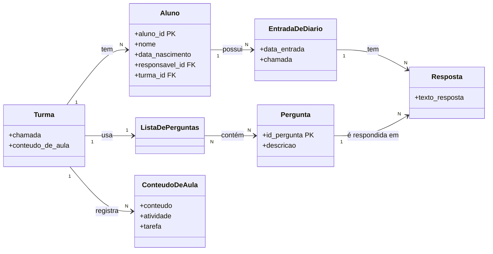

# Documento de Requisitos — AppEscola

## Sumário

1. [Introdução](#1-introdução)
2. [Visão geral do sistema](#2-visão-geral-do-sistema)
3. [Regras de negócio](#3-regras-de-negócio)
4. [Histórias de usuário — Professor](#4-histórias-de-usuário--professor)
5. [Histórias de usuário — Responsáveis](#5-histórias-de-usuário--responsáveis)
6. [Histórias de usuário — Responsáveis e professores](#6-histórias-de-usuário--responsáveis-e-professores)
7. [Funcionalidades](#7-funcionalidades)
8. [Requisitos não funcionais](#8-requisitos-não-funcionais)
9. [Modelagem de classes (parcial)](#9-modelagem-de-classes-parcial)
10. [Detalhes de implementação identificados](#10-detalhes-de-implementação-identificados)
11. [Glossário](#11-glossário)
12. [Referências](#12-referências)

---

## 1. Introdução

### 1.1 Propósito

Este documento formaliza as questões identificadas para o sistema. Ele orienta o desenvolvimento e ajuda a alinhar a visão e as expectativas dos stakeholders.

### 1.2 Escopo

#### Objetivo do sistema

O sistema facilita a comunicação entre os pais e a escola. Os pais podem ver ocorrências, tarefas e outras informações sobre o filho ou a filha. Essas informações são lançadas no sistema pelos professores ou pela direção.

#### O que o sistema não é

O sistema não permite que os alunos enviem tarefas. Ele também não controla prazos de atividades nem a devolução de correções pelos professores. Essas funções já são cobertas por plataformas consolidadas, como o Google Classroom.

### 1.3 Público-alvo do documento

A equipe de desenvolvimento do AppEscola e os clientes do sistema.

## 2. Visão geral do sistema

### 2.1 Descrição do sistema

O sistema tem duas classes de usuário: **responsável** e **professor**.

- O **professor** gerencia suas turmas. Ele lança informações no nível da turma e no nível do aluno e pode criar, ler, editar e excluir (CRUD) esses registros.
- Os **pais** consultam as informações lançadas pelos professores e pela direção.
- Os dois perfis podem ver os horários de aula e o mural da escola.

O app se integra ao sistema de gestão que a escola já usa (ERP), lendo e criando registros por meio de requisições. Para manter a complexidade sob controle e separar responsabilidades, o sistema é dividido em **dois aplicativos**: um para professores e outro para responsáveis.

### 2.2 Partes interessadas

1. Pais e responsáveis
2. Professores
3. Direção e coordenação da escola
4. Time de desenvolvimento do app
5. Desenvolvedor do backend e Product Owner

### 2.3 Classes de usuário

1. **Professor:** gerencia suas turmas e controla as informações de turma e de aluno.
2. **Responsável:** acompanha os registros dos filhos e as informações da escola que interessam a eles ou à família.

## 3. Regras de negócio

### Login

- **RN01.** O professor faz login com CPF e uma senha cadastrada no backend.
- **RN02.** O responsável faz login com CPF ou CNPJ e uma senha cadastrada no backend.

### Ocorrências e anotações

- **RN03.** O professor pode registrar ocorrências e anotações para um aluno da sua turma.
- **RN04.** Depois de registrada pelo professor, a ocorrência precisa ser validada pela direção antes de chegar ao responsável.
- **RN05.** Ocorrências e anotações têm quatro atributos principais: disciplina, data, tipo e descrição.
- **RN06.** Os tipos (ou rótulos) são definidos pela própria escola e ficam padronizados no sistema. Exemplo: "Conflitos com colegas".
- **RN07.** A disciplina é opcional. Um registro sem disciplina aparece como "Geral".

### Anotações

- **RN08.** Diferente das ocorrências, as anotações **não** são enviadas aos responsáveis.

### Diário: chamada e lista de perguntas

- **RN09.** Cada diário se refere a um único aluno.
- **RN10.** O diário reúne a presença do aluno e a lista de perguntas. A lista de perguntas é uma extensão do formulário do diário.
- **RN11.** Só o professor que escreveu as respostas e a direção podem editá-las.
- **RN12.** A direção define antes as perguntas da lista. A chamada é padrão e sempre faz parte do diário.
- **RN13.** Turmas até o 5º ano têm uma chamada por dia.
- **RN14.** A lista de perguntas de um dia só pode ser respondida depois da chamada desse dia.
- **RN15.** A chamada só pode ser lançada quando todos os alunos estão marcados com presença ou falta.

### Mural e comunicados

- **RN16.** O mural e os comunicados são os mesmos para todos os usuários, professores e responsáveis, sem filtro por turma.
- **RN17.** As informações do mural ficam publicadas por tempo indeterminado, até a direção alterá-las.
- **RN18.** Os comunicados têm prazo de validade, definido pela direção quando são criados.
- **RN19.** Mural e comunicados têm título, descrição e uma imagem opcional.

## 4. Histórias de usuário — Professor

| ID | História | Tipo de informação |
|---|---|---|
| HU01 | **Selecionar turma.** Como professor, quero selecionar uma turma para lançar e atualizar os registros dela e para achar um aluno e cuidar dos registros dele. | — |
| HU02 | **Listar alunos.** Como professor, quero ver os alunos de uma turma para acessar o registro de cada um e gerenciar suas informações. | — |
| HU03 | **Lançar anotação.** Como professor, quero registrar anotações sobre comportamento, desempenho ou outras questões do aluno, para que outros professores ou a direção possam consultar depois. | Informação de aluno |
| HU04 | **Lançar ocorrência.** Como professor, quero registrar ocorrências em sala, como comportamento inadequado ou situações especiais, para manter um registro formal, ajudar na gestão da turma e na comunicação com os pais. | Informação de aluno |
| HU05 | **Fazer chamada.** Como professor, quero fazer a chamada das aulas para manter a frequência em dia e registrar cada falta na disciplina certa. | Informação de aluno |
| HU06 | **Responder lista de perguntas.** Como professor, quero preencher o diário de cada criança com a rotina dela na escola, para informar o dia a dia e facilitar a comunicação com os responsáveis. | Informação de aluno |
| HU07 | **Lançar conteúdo de aula na agenda.** Como professor, quero registrar na agenda o conteúdo de cada aula, para que alunos e responsáveis saibam o que foi ensinado e possam estudar em casa. | Informação de turma |

## 5. Histórias de usuário — Responsáveis

| ID | História |
|---|---|
| HU08 | **Selecionar ano letivo.** Como responsável, quero escolher um ano letivo em que meu filho estudou na escola, para ver as informações de anos anteriores. |
| HU09 | **Selecionar criança.** Como responsável, quero escolher de qual filho vou ver as informações, para acompanhar todos no mesmo app. |
| HU10 | **Consultar chamada.** Como responsável, quero ver a frequência do meu filho para saber se ele vai às aulas regularmente. |
| HU11 | **Gerar segunda via do boleto.** Como responsável, quero gerar a segunda via do boleto para pagar a mensalidade em dia. |
| HU12 | **Consultar agenda.** Como responsável, quero ver o que foi dado em cada aula, para ajudar na revisão ou para que meu filho estude o conteúdo de uma aula que perdeu. |
| HU13 | **Consultar diário.** Como responsável, quero ler o diário para conhecer a rotina do meu filho e o que o professor relatou, e acompanhar se as necessidades dele estão sendo atendidas. |

## 6. Histórias de usuário — Responsáveis e professores

| ID | História | Tipo de informação |
|---|---|---|
| HU14 | **Consultar cardápio.** Como usuário, quero ver o cardápio da escola para saber o que meu filho ou aluno está comendo. | — |
| HU15 | **Consultar comunicados.** Como usuário, quero ler os comunicados da escola para saber de eventos, mudanças e outros avisos importantes. | — |
| HU16 | **Consultar mural.** Como usuário, quero ver o mural da escola para acompanhar as novidades e os eventos. | — |
| HU17 | **Consultar horários.** Como usuário, quero ver o horário de aulas de um dia para saber quais disciplinas a turma terá. | Informação de turma |

## 7. Funcionalidades

### 7.1 Chamada e diário

- **F01.** Se o professor preencher a lista de perguntas de uma data sem ter feito a chamada, o sistema marca presença automaticamente para o aluno.
- **F02.** Se o professor preencher a lista de perguntas de uma data em que o aluno tem falta, o sistema permite, mas mostra um alerta.
- **F03.** O sistema permite ver o diário por data.

### 7.2 Funcionalidades para professores

1. Registrar presença
2. Registrar ocorrências
3. Registrar o diário
4. Registrar anotações sobre o aluno
5. Acompanhar o progresso dos alunos
6. Ver seus horários de aula
7. Ver o mural
8. Ver os comunicados

### 7.3 Funcionalidades para responsáveis

1. Ver a presença do aluno
2. Ver na agenda os conteúdos e módulos de cada aula
3. Ver ocorrências e registros do diário
4. Ver os horários de aula
5. Ver o mural
6. Ver comunicados e ocorrências

## 8. Requisitos não funcionais

| ID | Categoria | Requisito |
|---|---|---|
| RNF01 | Usabilidade | Seguir princípios de design e ter uma interface amigável [[1]](#12-referências). |
| RNF02 | Privacidade | Seguir a LGPD, principalmente para dados sensíveis das crianças, como nome e CPF. |
| RNF03 | Performance | Usar cache nas chamadas de API para reduzir o tempo de resposta e melhorar a experiência de uso. |
| RNF04 | Autorização | Validar a autorização das chamadas de API e pedir login de novo quando a sessão expirar. |
| RNF05 | Responsividade | Adaptar a interface às diferentes plataformas em que o app rodar. |

## 9. Modelagem de classes (parcial)

### Entidades

| Entidade | Descrição |
|---|---|
| **Aluno** | Aluno registrado no sistema. Pertence a uma turma e tem várias entradas de diário. |
| **Turma** | Turma com alunos. Tem uma lista de perguntas e vários conteúdos de aula (conteúdo, atividade e tarefa). |
| **Entrada de diário** | Registro diário de um aluno. Inclui a chamada e as respostas da lista de perguntas. |
| **Lista de perguntas** | Conjunto de perguntas ligado a uma turma. |
| **Pergunta** | Uma pergunta que pode aparecer em várias listas. |
| **Resposta** | Resposta a uma pergunta dentro de uma entrada de diário. |

### Considerações de implementação

1. **Salvar respostas e presença.** Ao salvar uma resposta da lista de perguntas, verificar se a presença da entrada de diário já está definida. Se não estiver, marcar o aluno como presente (ver F01).
2. **Restringir a edição das respostas.** Conferir o `autorId` antes de permitir a edição. Só o autor ou a direção podem alterar (ver RN11).
3. **Validar a chamada completa.** Antes de gravar a chamada, conferir se todos os alunos da turma estão marcados como presentes ou ausentes (ver RN15).

## 10. Detalhes de implementação identificados

1. A cada ano letivo, os registros de aluno e de responsável são copiados com novos IDs.
2. Um aluno pode ter mais de um responsável, mas cada registro de responsável está ligado a um único aluno. Quando um responsável tem N filhos, existem N registros dele, um para cada filho.
3. As informações do aluno ficam ligadas ao aluno, não à matrícula na turma. Assim, uma busca por CPF recupera os registros de anos anteriores, mesmo com o ID do aluno mudando a cada ano.

## 11. Glossário

| Termo | Definição |
|---|---|
| **Turma** | Cada sala, formada por alunos e professores. É identificada pela série e pelo grau. Ex.: 5º B do Fundamental (série 5º B, grau Fundamental). |
| **Grau** | Ex.: Fundamental I, Fundamental II, Médio. |
| **Série** | Ex.: primeira, segunda, terceira… |
| **Informação de turma** | Registro que vale para a turma inteira. |
| **Informação de aluno** | Registro ligado a um aluno específico. |
| **Ocorrência** | Registro formal de um evento com um aluno. O professor lança, a direção valida e então o responsável é avisado. Ex.: o aluno não fez a tarefa. É uma informação de aluno. |
| **Anotação** | Registro do professor sobre o aluno que fica visível só para outros professores, sem ir para o responsável. Ex.: o aluno tem dificuldade em divisão com decimais. É uma informação de aluno. |
| **Disciplina** | Cada matéria dada à turma. Ex.: Matemática. |
| **Diário** | Conjunto de registros diários do professor sobre o aluno, para os responsáveis acompanharem. É uma informação de aluno. |
| **Entrada de diário** | Cada registro do diário numa data. Reúne a chamada e a lista de perguntas. |
| **Chamada** | Registro de presença feito uma vez por dia para cada aluno. É uma informação de aluno. |
| **Lista de perguntas** | Formulário com perguntas definidas pela direção sobre a rotina do aluno. |
| **Horários de aula** | As aulas e seus horários em cada dia ou semana. É uma informação de turma. |
| **Agenda** | Metáfora de interface [[2]](#12-referências) de uma agenda de papel, mostrando o conteúdo de cada aula em cada data. |
| **Comunicado** | Aviso da direção para professores e responsáveis, com prazo de validade definido na criação. |
| **Mural** | Quadro com informações gerais e eventos de interesse de toda a escola. |
| **Cardápio** | O que compõe as refeições dos alunos. |
| **CRUD** | As operações básicas sobre dados: Create (criar), Read (ler), Update (atualizar) e Delete (excluir). |
| **Responsividade** | Capacidade de um sistema se adaptar a diferentes tamanhos de tela e dispositivos, como celulares, tablets e computadores. |
| **LGPD** | Lei Geral de Proteção de Dados, a lei brasileira sobre uso de dados pessoais, com atenção especial a dados sensíveis, como os de crianças. |

## 12. Referências

1. NIELSEN, Jakob. [Usability 101: Introduction to Usability](https://www.nngroup.com/articles/usability-101-introduction-to-usability/). Nielsen Norman Group, 3 jan. 2012.
2. REBELO, Irla. [Metáforas de Interação Humano-Computador](https://irlabr.wordpress.com/apostila-de-ihc/4-metaforas/). Apostila de IHC.
