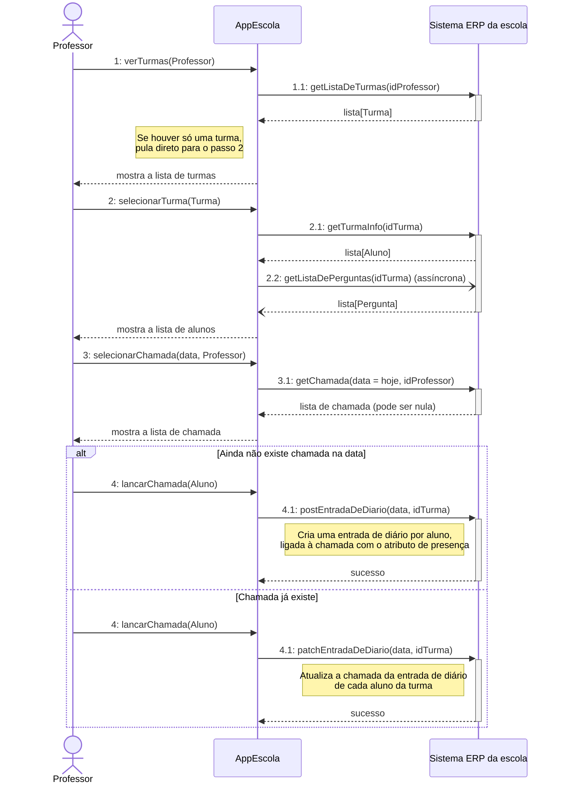

# Diagrama de sequência — Fazer chamada

Relacionado a: [HU05](../requisitos/documento-de-requisitos.md#4-histórias-de-usuário--professor), [RN13–RN15](../requisitos/documento-de-requisitos.md#3-regras-de-negócio).
Fonte original: [`fonte/fazer-chamada.txt`](fonte/fazer-chamada.txt) (formato [sequencediagram.org](https://sequencediagram.org)).

