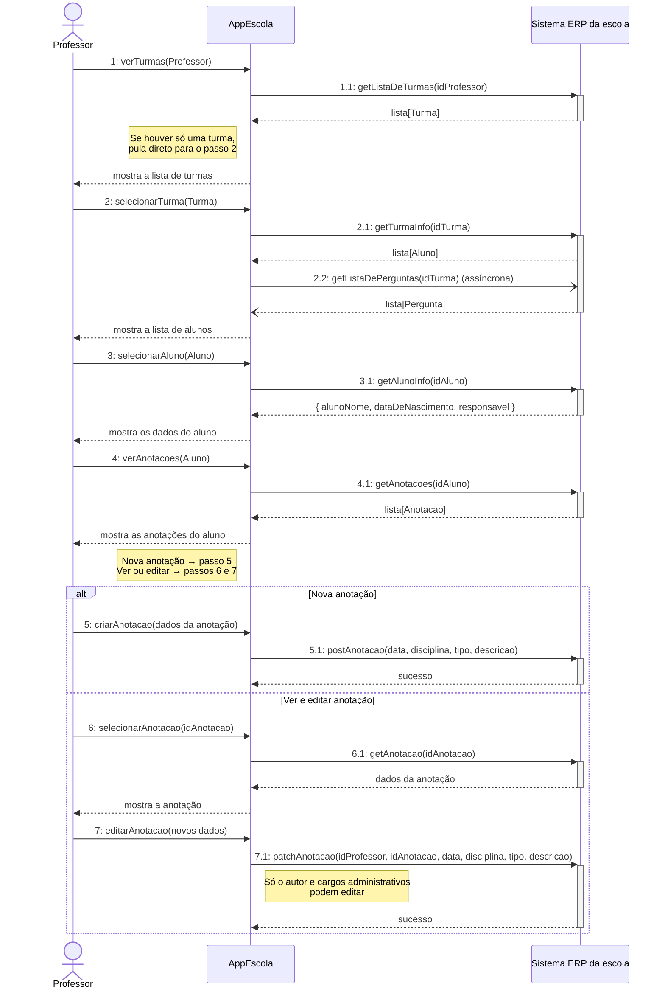

# Diagrama de sequência — Lançar anotação

Relacionado a: [HU03](../requisitos/documento-de-requisitos.md#4-histórias-de-usuário--professor), [RN03–RN08](../requisitos/documento-de-requisitos.md#3-regras-de-negócio).
Fonte original: [`fonte/lancar-anotacao.txt`](fonte/lancar-anotacao.txt) (formato [sequencediagram.org](https://sequencediagram.org)).

