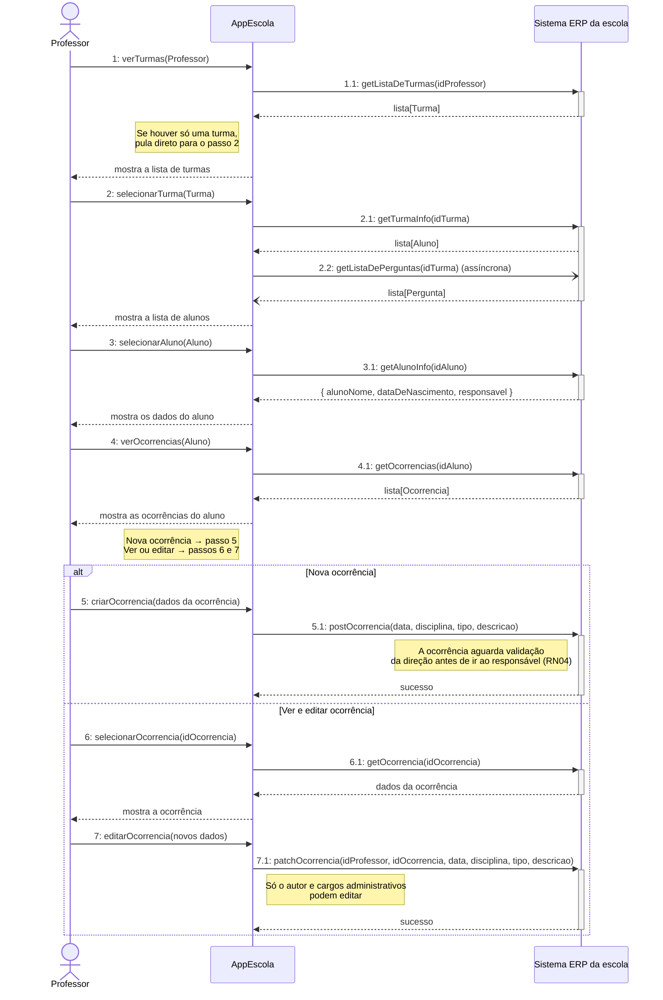

# Diagrama de sequência — Lançar ocorrência

Relacionado a: [HU04](../requisitos/documento-de-requisitos.md#4-histórias-de-usuário--professor), [RN03–RN07](../requisitos/documento-de-requisitos.md#3-regras-de-negócio).
Fonte original: [`fonte/lancar-ocorrencia.txt`](fonte/lancar-ocorrencia.txt) (formato [sequencediagram.org](https://sequencediagram.org)).

