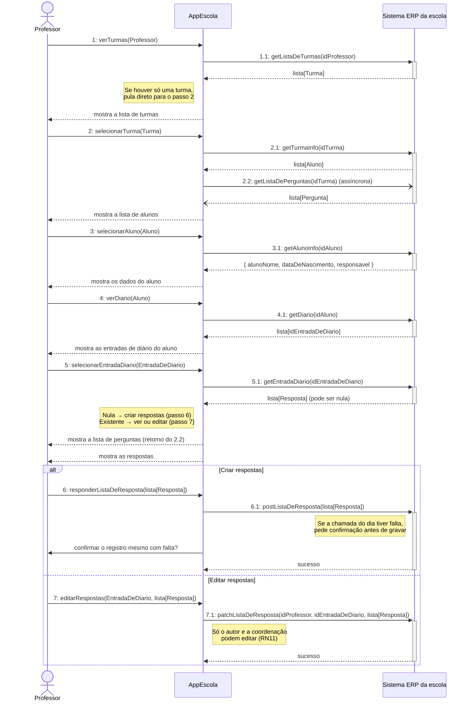

# Diagrama de sequência — Responder lista de perguntas

Relacionado a: [HU06](../requisitos/documento-de-requisitos.md#4-histórias-de-usuário--professor), [RN09–RN14](../requisitos/documento-de-requisitos.md#3-regras-de-negócio), [F01–F02](../requisitos/documento-de-requisitos.md#7-funcionalidades).
Fonte original: [`fonte/responder-lista-de-perguntas.txt`](fonte/responder-lista-de-perguntas.txt) (formato [sequencediagram.org](https://sequencediagram.org)).

